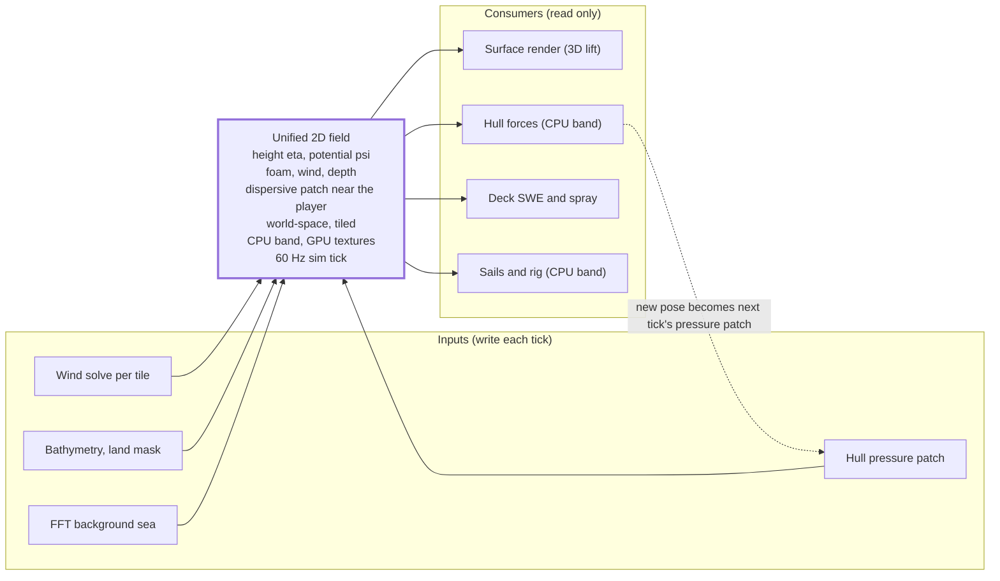

# Real-Time Ocean Plan: Where We Are

Oct 24, 2026 · @Niilo

## Bottom line

The ocean is buildable in the browser from existing techniques; nothing in the physics is novel. The novelty is one unified 2D world-state that every system (waves, wakes, wind, hull forces, deck water) reads and writes, lifted to 3D only at render time. Target budget is 3–5 ms GPU on an RTX 4060 / RX 7600 class card, with full wake and deck simulation limited to the player and 2–3 nearby boats.

Two things stay faked, because no real-time method exists: plunging breakers against a hull, and true 3D green water. Both are triggered from the 2D state and rendered with particles and decals.

## The unified 2D field

Everything lives in a tiled, world-space texture stack; the 3D surface is just a vertex shader reading it. The hull enters the field as a **moving pressure patch** (hydrostatic pressure of the hull footprint as a forcing term), not as a carved-out shape — the same array that gives buoyancy drives the wake.

One 2D field feeds render, forces and deck water.

Inputs on the left write into the field each tick; consumers on the right only read it. The one loop is the rigid body's new pose becoming the next tick's hull pressure patch. Hull forces and the sails read the sea through the environment query on the CPU band, the same components the renderer draws below the cut wavenumber; the GPU field is the visual layer (ADR 0005).

| Layer                      | Technique                                                                                                                                                                                                                                                                                                                                                                                                                            | Scale / notes                                                                                                                                           |
| -------------------------- | ------------------------------------------------------------------------------------------------------------------------------------------------------------------------------------------------------------------------------------------------------------------------------------------------------------------------------------------------------------------------------------------------------------------------------------ | ------------------------------------------------------------------------------------------------------------------------------------------------------- |
| Background sea             | JONSWAP-TMA with Donelan-Banner spreading; N = 128 equal-energy analytic components (128 at most) below the cut wavenumber k\_s, shared with the CPU, plus three FFT cascades (four at most) above it; choppy displacement plus bound waves, the second-order vertical correction at each point's Lagrangian label in a calibrated factorised form, so crests stand sharper than troughs; the tail stays linear (ADR 0005, ADR 0011) | Whole 2–3 km view; 114 to 120 fps from the helm and 94 to 98 from 20 m on an M1 Pro at 2560x1440, foam off (ADR 0005); clipmap mesh with CDLOD morphing |
| Foam / whitecaps           | Jacobian of displacement marks folding, the band's Jacobian included; advected, decaying foam buffer shared with wakes; Dupuy and Bruneton filtered coverage beyond the buffer, with the breaking threshold solved from a cited whitecap coverage law (Brumer et al. 2017) and Dierssen 2019 reflectance (ADR 0011)                                                                                                                  | One world-space buffer, injected at hull–water contact by relative speed                                                                                |
| Micro detail / reflections | Highest cascade + detail normals; per-cascade slope moments plus the band's exact slope covariance, with a Cox and Munk floor; Fresnel against the precomputed atmosphere, approximate SSS; SSR and probes deferred (ADR 0011, ADR 0012)                                                                                                                                                                                             | Filtering stops far-field shimmer                                                                                                                       |
| Local dispersive patch     | Jeschke & Wojtan 2023 dispersive shallow water in a moving window (\~256–512 m) around the player                                                                                                                                                                                                                                                                                                                                    | Wakes with correct Kelvin pattern, run-up, depth refraction, harbour-wall reflection                                                                    |
| Wake LOD                   | Player + nearby: dispersive patch. Everyone else: analytic Kelvin texture (Michell) + foam trail                                                                                                                                                                                                                                                                                                                                     | Add wave-particle patches (Xue 2025) for AI ships only if needed                                                                                        |
| Bathymetry / land mask     | Procedural depth and obstacle maps                                                                                                                                                                                                                                                                                                                                                                                                   | Drives shoaling, attenuation, and the wind solver                                                                                                       |
| Wind field                 | Runtime 2D solve per streamed tile (see Wind)                                                                                                                                                                                                                                                                                                                                                                                        | 25–50 m cells, \~1 Hz update                                                                                                                            |
| Hull pressure patch        | Draft map + hull velocity rasterised top-down each tick                                                                                                                                                                                                                                                                                                                                                                              | Input to the patch solver, output to buoyancy                                                                                                           |
| Deck water                 | Per-ship SWE grid in ship-local frame (see Deck water)                                                                                                                                                                                                                                                                                                                                                                               | 128²–256², player and 2–3 nearest                                                                                                                       |

Seam between patch and background: carry surface height _and_ surface potential (the Hamiltonian (η, ψ) state from the 2026 coupling paper) so the patch edge does not reflect. Choppy displacement makes the FFT output non-injective, so height queries need a 2–3 step inverse-displacement lookup; keep the result as a precomputed layer.

## Islands and harbours

Plain FFT has no shoaling, refraction, diffraction or reflection, so coastal behaviour comes from two sources. Far from the player, the FFT tail may be modulated freely by procedural bathymetry and a per-tile obstacle attenuation map (less energy in the lee of an island). The CPU band may take an amplitude envelope from an authoritative attenuation map, but its wavenumbers never vary pointwise (ADR 0005): shorter, steeper waves over shallows are the dispersive patch's job near the player, and far-field refraction would need ADR 0005 amended, at build step 7. Near the player, the dispersive patch takes over and does reflection off quays, wave shadowing behind skerries and run-up on beaches natively.

Overhanging breakers are the one coastal feature the heightfield cannot represent. Horizon Forbidden West's answer — baked breaker meshes placed along shorelines — is the known fix; for a procedural Baltic it is a later, optional layer, and the shoreline here is mostly rock, not surf.

## Wind

A coarse runtime 2D solve replaces offline CFD, because a procedural whole-Baltic world cannot be pre-baked. Solve a potential-flow or shallow-water field over the land/height mask once per streamed tile, cache it, and re-solve when the wind direction shifts by more than \~10°. A 256² grid at 25–50 m cells needs only \~1 Hz, so it runs on the CPU as the Separation of concerns tab requires: the sails feel the field, so it is authoritative, and the renderer reads it.

What the 2D solve lacks is added analytically:

- **Vertical structure:** scale an obstacle's blocking by its terrain height and apply a Jensen-type wake deficit (∝ 1/(1 + kx/h)²) so a tall island shadows 10–20× its height downwind.
- **Gusts and lulls:** von Kármán/Kaimal-shaped noise advected downwind, amplitude raised in lee zones and behind headlands.
- **Mesoscale:** procedural sea-breeze component by time of day near coasts; a slow gradient field for fronts.
- **Lee rotors / downdrafts:** skipped; needs 3D and barely occurs on low Baltic islands.

The same field drives the local wave spectrum (fetch-limited sea in a lee) and the sails. Grid-based beats per-island analytic shadow cones in the archipelago, where thousands of small islands overlap; a 25 m grid resolves a 200 m skerry as 8 cells.

## Physics coupling

Two-way, asymmetric, loosely coupled, and only at the local layer. This is how Raging Rapids (NVIDIA), Sea of Thieves and the LBM shallow-water work all do it, and it is stable at a one-tick lag because the ship's mass dwarfs the per-step change in displaced water.

| Pair                    | Direction               | Mechanism                                                                                         |
| ----------------------- | ----------------------- | ------------------------------------------------------------------------------------------------- |
| FFT background → ship   | One-way                 | Ship samples height, normal, orbital velocity; a hull does not alter swell                        |
| Dispersive patch ↔ ship | Two-way                 | Ship → water: hull pressure patch as forcing. Water → ship: combined field sampled at hull panels |
| Deck SWE ↔ ship         | Two-way, mass only      | Inflow where ocean height exceeds rail; feedback = moving mass on the rigid body                  |
| Wind ↔ ship             | One-way (+ sail thrust) | Field sampled per hull part and sail; large hulls may locally shadow the field later              |

Forces per hull panel, from Kerner's method (under 1 ms per boat):

1. Hydrostatic + Froude–Krylov: ρg·(h\_water − z\_panel) using the sampled local height. Gives wave-induced heave, pitch and roll for free.
2. Added mass and radiation damping: empirical coefficients per axis, not simulated.
3. Viscous drag: quadratic in relative velocity (orbital velocity minus panel velocity). This is what lets a wave push a hull sideways.
4. Slamming: impulse when relative normal velocity at panel entry exceeds a threshold; also spawns spray.

Do not extract dynamic pressure from the 2D wave solver; its dynamic pressure is wrong. Compute buoyancy from submerged volume, never as a penetration spring.

Per fixed 60 Hz tick, CPU first:

1. Environment query on the CPU: the band's height and orbital velocity at every sample point, wind by the log profile, depth (ADR 0005).
2. Rigid body integrates with the forces above; the rig and sails step with it.
3. Rasterise the new hull pressure patch for the next tick; deck SWE runs after.
4. The GPU renders the newest completed tick: the band drawn analytically, the FFT cascades above the cut, then the dispersive patch using that tick's hull pressure patch (ADR 0003, ADR 0011).

Stability rules: low-pass the hull patch over 2–3 ticks; clamp water→ship accelerations. Nothing is read back from the GPU, so there is no readback latency to hide (ADR 0003).

## Deck water and spray

Deck water is a 2D shallow-water sim in the ship's local frame, not FLIP. The deck is static in local coordinates, so obstacles (masts, hatches, bulwarks, scuppers as drain cells) are a mask baked once per ship type. Ship motion enters as body forces: `g_local = R⁻¹·g − a_ship − ω×(ω×r) − α×r`, which makes water run to the lee rail on heel and rush aft on pitch.

- Inflow at rail cells where `h_ocean > h_rail`: volume ∝ `(h_ocean − h_rail) × v_rel_normal × dt`; impulsive sources on bow slams.
- Outflow through scuppers and over the rail when the sheet exceeds rail height.
- Feedback: sheet mass and centroid added to the rigid body as a moving mass (free-surface effect).
- Particles only at events — wave crossing the rail, SWE cells hitting an obstacle at speed, bow slam. 10–30k GPU particles, ship-local, \~1 s lifetime, volume returned to the grid.

Cost: 128²–256² grid at 2–4 substeps is 0.2–0.5 ms; \~1 ms sim + \~0.5 ms render per active ship. Runs on async compute after the ocean pass and before ship rendering; the renderer draws the newest completed tick without interpolation, like the ship pose; interpolating between two height textures is the deferred option, taken only if the 60 Hz step shows at the frame rate (ADR 0003).

## Browser constraints

WebGPU compute is required for the FFT and the dispersive patch; the wind solve is CPU work. There is no WebGL2 fallback, since the renderer is raw WebGPU (ADR 0001). Safari ships WebGPU, so coverage is acceptable.

- Nothing is read back from the GPU: no `mapAsync`, no rigid body in a compute shader. The renderer draws the newest completed tick from the state buffer, and GPU results never enter authoritative state (ADR 0003).
- Run physics in a Worker with SharedArrayBuffer; the main thread only renders.
- Background heights at hull samples are evaluated analytically from the CPU band, the same components the renderer draws, never read from the FFT texture; that is what makes multiplayer determinism possible (ADR 0005).
- The full HOS solver from the 2026 paper (hundreds of FFTs per substep) does not fit a WebGPU budget; take only its pressure-patch and (η, ψ) ideas.

## Key references

- [Tessendorf-style FFT ocean, Godot implementation with TMA spectrum and cascades](https://github.com/sebbasim/GodotOceanWaves)
- [Real-time Ocean Whitecaps, Dupuy & Bruneton](https://liris.cnrs.fr/Documents/Liris-5812.pdf)
- [Dierssen 2019, whitecap and foam reflectance from visible to shortwave infrared (Frontiers in Earth Science, CC BY)](https://doi.org/10.3389/feart.2019.00014)
- [Brumer et al. 2017, whitecap coverage dependence on wind and wave statistics (J. Phys. Oceanogr.)](https://doi.org/10.1175/JPO-D-17-0005.1)
- [Water Surface Wavelets, Jeschke et al. 2018](https://pub.ista.ac.at/group_wojtan/projects/2018_Jeschke_WaterSurfaceWavelets/WaterSurfaceWavelets.pdf)
- [Generalizing Shallow Water Simulations with Dispersive Surface Waves, Jeschke & Wojtan 2023](https://research.nvidia.com/labs/prl/shallow-water-simulation)
- [Real-Time Interactive Hybrid Ocean: Wave Particle–FFT Coupling, Xue et al. 2025](https://arxiv.org/abs/2511.02852v1)
- [Hamiltonian Two-Way Coupling of Nonlinear Waves and 3D Flows, 2026](https://arxiv.org/abs/2608.25203)
- [Static vs dynamic pressure distribution for ship waves, Yao, Bingham & Zhang 2024](https://orbit.dtu.dk/en/publications/the-influence-of-static-versus-dynamic-pressure-distribution-stra/)
- [Raging Rapids Rides, Chentanez & Müller (two-way heightfield coupling)](https://history.siggraph.org/?p=149345)
- [Real-Time Open Water Environments with Interacting Objects, Cords & Staadt 2009](https://diglib.eg.org/items/95cc6b17-6d6f-406a-92f7-4f9444e40bb9)
- [Water interaction model for boats, Kerner](https://gamedeveloper.com/programming/water-interaction-model-for-boats-in-video-games)
- [The Technical Art of Sea of Thieves, SIGGRAPH 2018](https://history.siggraph.org/wp-content/uploads/2022/09/2018-Talks-Ang_The-Technical-Art-of-Sea-of-Thieves.pdf)
- [Rendering Water in Horizon Forbidden West, SIGGRAPH 2022](https://advances.realtimerendering.com/s2022/SIGGRAPH2022-Advances-Water-Malan.pdf)
- [Physically based wake simulation, Michell thin-ship theory (Liège thesis)](https://matheo.uliege.be/handle/2268.2/25042)
- [Wind-field gradients in real-time ship simulators (Flanders Hydraulics)](https://marineinfo.org/id/publication/359139)
- [Real-Time Ship Ocean: SOTA Brief (companion doc)](https://claude.ai/code/artifact/53d83e48-796c-4fea-a915-eec7a688ded8)
