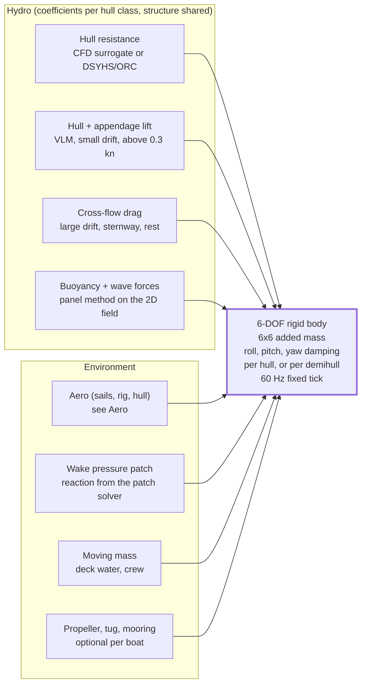

# Hull hydrodynamics

Oct 20, 2026 · @Niilo

## Bottom line

There is no single formula that covers a dinghy, an H-boat, a 96 m full-rigger and a catamaran, but one architecture does: an MMG-style modular force sum where each module gets class-specific coefficients derived from the actual hull geometry. Coefficients come from published regressions wherever the hull sits inside a regression's family (most of the fleet does); offline CFD is a calibration step reserved for hull shapes no regression has seen. Every hull shares the same appendage, cross-flow, wave and wake modules.

Michell thin-ship theory is dropped from the leeway and wake paths: it assumes the hull is slender along the direction of motion, so any drift angle produces spurious source strengths and an oversold wake. It survives only as an optional upright resistance curve for very slender hulls with no other data.

## Force modules

Eight force modules sum into one rigid body.

Each module returns a force and moment in the body frame; the rigid body sees only the sum. Lift and cross-flow drag are blended by drift angle and speed so exactly one of them carries the side force at any moment.

## Resistance: regressions first, geometry at heel, CFD only where they fail

Upright resistance versus speed comes from the regression whose family the hull belongs to. The hydrostatics that regression needs (waterline length, displacement, wetted area, prismatic and midship coefficients) are not read once from the drawing but recomputed from the hull mesh at the current heel, trim and sinkage every tick, so a hull whose sailing length grows when heeled (a J-Class with long overhangs) is handled by geometry rather than by a special case.

| Hull family                                          | Regression                                                                                           | Why it fits                                                                                                      | Example boats                     |
| ---------------------------------------------------- | ---------------------------------------------------------------------------------------------------- | ---------------------------------------------------------------------------------------------------------------- | --------------------------------- |
| Merchant-type displacement hulls, L/B 5–9, Fn < 0.35 | Holtrop–Mennen for resistance; Kijima/Inoue for sway–yaw derivatives                                 | Built on exactly this population of steel cargo hulls                                                            | Suomen Joutsen (1902 cargo hull)  |
| Traditional wooden workboats, full keel, L/B 4–5     | Holtrop–Mennen (marginal at low L/B but usable); Kijima; cross-flow drag                             | Low Froude, modest heel, hull itself is the lifting body                                                         | Linden, Svanhild                  |
| Classic and modern fin-keel yachts                   | DSYHS (Keuning & Katgert 2008) with heel correction; ORC VPP residuary model                         | Hull sits inside the series                                                                                      | H-boat and most procedural yachts |
| Long-keel classics with overhangs                    | DSYHS with effective-at-heel hydrostatics; keel treated as part of the hull                          | Regressions never saw an integral keel; the Wolfson Unit J-Class VPP work shows standard VPPs need reformulation | J-Class                           |
| Wide, flat, planing maxis, Fn to 0.9                 | ORC 2013 LVR/BTR model for displacement speeds; Savitsky-type dynamic lift blended in above Fn ≈ 0.5 | Beyond DSYHS range and family; dynamic trim and planing lift dominate                                            | Volvo Open 70                     |

Where a hull leaves every regression's family, run offline CFD (OpenFOAM) to calibrate: a handful of heeled free-surface runs for the long-keel classic, about twenty speed × heel runs to set the planing blend for the maxi, and nothing for the rest of the fleet. The split is cheap because free surface matters only for resistance versus speed; the drift problem is calibrated with double-body runs or, usually, not at all (see Side force). Budget per calibrated hull: well under a day on a workstation. A full free-surface grid of 60–100 points is never needed.

Viscous resistance is ITTC-57 friction with a form factor and wetted area from the geometry at the current heel and sinkage. Resistance is evaluated for both surge directions so sternway is drag-limited, never undefined. Added resistance in waves comes from the panel method, not from a regression.

## Side force: lift at small drift, cross-flow drag at large

Side force, yaw moment and induced drag at leeway are a lifting-body problem. Solve it live with a vortex-lattice method (VLM) on the submerged hull, keel and rudder: 300–800 panels per boat, mirrored at the free surface (rigid-wall image at low Fn, anti-image at high Fn, blended between). Geometry is rigid, so the influence-matrix inverse is precomputed per hull and per heel bin; the per-tick solve is a matrix–vector product. This gives keel–rudder upwash, heel-induced side force and rudder behaviour in the keel wake, which no regression captures. The same solver covers every keel topology without special cases: a fin keel and spade rudder (H-boat), a low-aspect keel integral with the hull (J-Class, the schooners, where the hull itself is the lifting surface), and a canting keel with daggerboards and twin rudders (Volvo Open 70), where the keel is simply a lifting body at its own cant angle and the windward rudder's panels lose weight as they lift clear of the water.

Beyond about 15–20° drift, or at any speed below \~0.3 kn, lift theory is meaningless. There the hull module uses Hooft/Obokata cross-flow drag: integrate ½ρ·C\_D(x)·|v\_n|·v\_n over hull sections, with C\_D from section shape, plus linear manoeuvring derivatives (Y\_v, N\_v, Y\_r, N\_r) from the CFD grid or Kijima regressions. Keel and rudder become bluff plates in this regime.

The blend is the one place to tune carefully: a weight on both drift angle and speed, smooth enough that the handoff is invisible when a boat stalls out of a tack or gathers sternway.

## Rigid body, buoyancy and damping

Six-DOF rigid body per boat with an explicit 6×6 added-mass matrix (sway and roll added mass are large for keeled hulls, largest for a long-keel classic) and roll, pitch and yaw damping terms. Without these the drift onset is too snappy and heel overshoots on every gust. Righting moment is never a coefficient: it comes from the panel buoyancy against the mass distribution, so a canted keel bulb, pumped water ballast or crew on the rail change stability by moving mass, nothing else.

Buoyancy and wave excitation come from the panel method defined in the ocean tab: hydrostatic plus Froude–Krylov pressure on each submerged panel using the sampled local surface height, orbital velocity in the relative-velocity term, and slamming impulses at panel entry. The calm-water CFD surrogate never sees waves; wave forces are always added by the panel method so the two do not double-count.

Moving mass from the deck shallow-water sim, crew positions, water ballast and a canting keel is added to the rigid body each tick.

## Wake

The wake source is the hull's hydrostatic pressure footprint (the Yao, Bingham & Zhang moving-pressure model), rasterised from the actual submerged shape each tick and applied to the dispersive patch solver as a forcing term advected along the hull's true velocity vector. The footprint rotates with the hull, so leeway, heel and sternway all produce the right pattern, and the same array feeds buoyancy. The Kelvin feather pattern and its narrowing at high Froude number come from the dispersive solver, not from a separate wake model.

## Multihulls

Every module above is per-hull, so a catamaran is two hull modules plus their interference. Resistance: a CFD surrogate of the full platform where it matters, otherwise a demihull resistance with Insel–Molland wave and viscous interference factors as functions of separation and Fn. Side force: VLM panels on both hulls and all appendages. Flying a hull is just one hull's buoyancy and wetted area going to zero in the panel method. Cross-flow drag integrates over both hulls independently.

## Emergent cases

All three are emergent if the modules below are present; none is scripted.

| Case                                          | Dominant modules                                                                                                                                                                                                                                                                      | What must be true                                                                         |
| --------------------------------------------- | ------------------------------------------------------------------------------------------------------------------------------------------------------------------------------------------------------------------------------------------------------------------------------------- | ----------------------------------------------------------------------------------------- |
| Lying ahull, drifting sideways from rest      | Cross-flow drag on hull, keel and rudder; sway added mass; aero side force                                                                                                                                                                                                            | VLM weight is zero below \~0.3 kn; drift settles at roughly 0.5–1.5 kn with a little heel |
| Sternway (box-hauling, backing off a mooring) | Resistance table with negative surge; VLM and cross-flow using the true inflow vector; ±180° sail polars                                                                                                                                                                              | Rudder lift and turning sense reverse automatically; wake advects bow-first               |
| Broaching on a following sea                  | Panel buoyancy + Froude–Krylov (wave slope and orbital velocity); heel axis in the surrogate or heeled VLM geometry; rudder panels de-weighted by submergence and a stall branch in the rudder polar; roll damping and roll–yaw coupling; spinnaker heeling moment from the cloth sim | Surrogate covers β to \~40° and heel to \~45°, or hands off cleanly to cross-flow drag    |

The sequence a broach should produce: stern lifts on the wave face → rudder bite drops → heel builds from the spinnaker → heel-induced yaw adds to the wave yaw moment → round-up.

## Validation targets

- H-boat: match ORC-style polars (VMG upwind, speeds at 60°, 90°, 120° TWA at 8 and 16 kn true) within \~5%.
- Suomen Joutsen: historical loggings (best around 14 kn, poor pointing); tacking fails without backing the headsails and succeeds with them.
- Sternway test: head to wind, yards braced square or jib backed, 1–2 kn astern with reversed rudder sense.
- Drift test: ahull in 20 kn, drift speed and heel against known values for the class.
- Volvo Open 70: 20+ kn reaching and 30+ kn surfing downwind in 25–30 kn true, with the planing blend calibrated so the speed–wind curve matches published race polars within \~10%; J-Class: heeled sailing length and speed against the J-Class Association VPP ratings. Where CFD calibration is run, its upright curve must agree with the regression within \~10% inside the regression's own range.

Sources:

- [Keuning & Katgert 2008, DSYHS bare hull resistance extended to higher speeds](https://research.tudelft.nl/en/publications/a-bare-hull-resistance-prediction-method-derived-from-the-results)
- [TU Delft 2016, new systematic yacht series and regressions](https://repository.tudelft.nl/file/File_b89cddac-c130-429c-9b24-b71e453a1061)
- [Data-driven models beyond DSYHS, IEEE Access 2024](https://doaj.org/article/04405607232a44288e378d40243ba492)
- [ORC VPP Documentation 2023](https://orc2.orc.org/rules/ORC%20VPP%20Documentation%202023.pdf)
- [Insel & Molland, resistance components of catamarans](https://eprints.soton.ac.uk/462776/1/457354.pdf)
- [ELIGMOS, MMG-based time-domain manoeuvring](https://strathprints.strath.ac.uk/58361/1/Pollalis_etal_MSO2016_ELIGMOS_time_domain_simulation_of_the_maneuvering_of_ships.pdf)
- [Static vs dynamic pressure distribution for ship waves, Yao, Bingham & Zhang 2024](https://orbit.dtu.dk/en/publications/the-influence-of-static-versus-dynamic-pressure-distribution-stra/)
- [Kerner, water interaction model for boats (panel buoyancy)](https://gamedeveloper.com/programming/water-interaction-model-for-boats-in-video-games)
