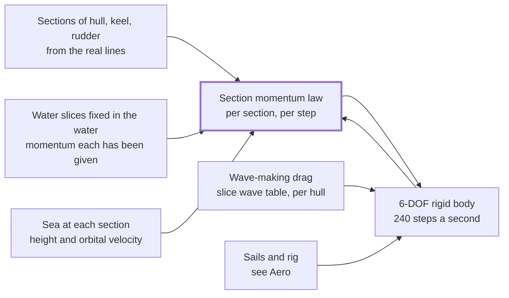

# Hull hydrodynamics

Nov 17, 2026 · @Niilo

## Bottom line

One law covers the hull, the keel and the rudder of every boat: the section (slice) momentum law. Each underwater body is a stack of transverse sections cut from the real lines, and each section trades momentum with the slice of water it is passing through. The slice is fixed in the water, so the water the keel has turned is still turning when the rudder reaches it. Side force, yaw moment, the rudder's grip and stall, weather helm growing with heel, the rudder airing in a broach, heave and pitch on waves and slamming are all what that law does on the immersed geometry at the current attitude (ADR 0014).

The hull family is data, never a code path. There are no modes, no flags, no speed or angle thresholds and no regression per hull family; a fin keel, a long keel, an integral keel on a full-rigged ship and a wide flat hull differ only in their sections. This replaces the earlier outline of a regression table per family, a vortex lattice with heel bins, a cross-flow strip, stall weights and a constant 6x6 added mass (ADR 0006 and ADR 0007, both superseded).

## What the law computes

The law reads the sections and the water slices; the rigid body sees the summed force.

Per section and per step, the law takes the immersed shape at the current heel, trim and sinkage, the section's velocity relative to the local water (orbital velocity included) and the momentum already in the water slice it is in. The force on the section is the rate at which it changes that momentum. From this one rule come:

- **Sideways force and yaw moment** of hull and keel at any leeway, ahead or astern, and the rudder's lift up to stall and its flat-plate force beyond it.
- **Wash:** the keel leaves turned water behind it, and the rudder works in it.
- **Heel effects:** the immersed sections change shape as she heels, so weather helm grows with heel, the lateral centre moves, and the rudder loses grip and draws air as it lifts towards the surface.
- **Vertical motion:** heave and pitch on waves, with hydrostatic and wave pressure from the sea at each section, and slamming when a section's water mass changes suddenly. A per-section wave-making memory (four numbers per section, passive for any parameters) carries the energy the boat radiates as waves; without it she hobby-horses four to five times too much.
- **The free tiller:** the rudder is a hinge with its own inertia, so a let-go tiller is a result, not a setting.

Righting moment is never a coefficient: it comes from buoyancy of the immersed sections against the mass distribution.

## What is data

Per boat: the sections of hull, keel and rudder from the real lines (the H-boat from her class offsets), the mass items and their positions, the rudder's hinge line and travel, and one precomputed table of upright wave-making drag against speed. Nothing in the law is fitted per boat or per family.

Wave-making drag is the one piece taken from a table rather than live, because the waves a hull makes at a given speed take seconds, not microseconds, to compute. The table comes from the slice wave method: each water slice is left with the waves the passing body-exact sections made, summed in Michell's weighting with no constant (ADR 0014). It is about a second per hull and speed on one core. It is provisional: for a typical heavy keelboat it runs about 0.4 knots slow near 5 knots and within 10% above 7 knots; heavy hulls come out slow, light hulls fast. The same slice waves are a candidate source for the visible wake later.

## Validated, and how well

"Good enough" is judged by feel and by order of magnitude together, not by a hard 5% gate. The owner's impressions give direction and ordering; a remembered figure of his is a rough band; tank measurements win over remembered figures; a mismatch is raised only when it is about a factor of two or of the wrong kind.

| Behaviour                                      | Evidence                                                         | Result                                                                                                       |
| ---------------------------------------------- | ---------------------------------------------------------------- | ------------------------------------------------------------------------------------------------------------ |
| Side force of hull and keel, upright           | 35 Delft hulls the law had never seen, 396 runs                  | Per-hull means 6% low to 13% high; centre 0.03 of the length aft of the tank's                               |
| Rudder                                         | Tank foils, free fins of aspect 1 to 3                           | Stalls and turns into a flat plate like the foils; peak lift 10 to 25% low                                   |
| Tack, H-boat, close-hauled to close-hauled     | Owner's race videos: 7 to 8 s                                    | 7.1 s at 20 degrees of helm, 6.1 s with the side-force fix                                                   |
| Weather helm against wind, H-boat close-hauled | Owner's feel; Perry: 2 to 4 degrees is best                      | About neutral at 4 m/s, 3 degrees at 6 m/s, 7 at 8 m/s, 10 at 10 m/s, 15 at 12 m/s                           |
| Broach                                         | Owner's feel                                                     | Emergent: helm runs out, rudder airs, she rounds up; easing the main saves her                               |
| Seaway, reference sea Hs 0.42 m, Tp 2.9 s      | Classical strip theory as a stand-in; no measured yacht data yet | Close-hauled 2.4 degrees of pitch rms, about 4 slams a minute, 0.17 knots lost                               |
| Wave-making drag                               | 36 Delft hulls, Wigley hull, Series 60 ship form                 | Median 1.0 to 1.7 of the tank from Froude 0.25 to 0.40, 0.7 to 0.85 above; Michell's sum alone is 2.8 to 3.8 |

The model runs at 240 steps a second and is stable there and at 120 on waves. How that relates to the 60 Hz determinism clock is under review (ADR 0013 status note).

The pass marks from the owner's own sailing are rough bands, not gates: a fin keel needs constant small corrections and a long keel tracks like on rails and turns 1.2 to 1.4 times slower; more rudder turns faster up to the tiller's real limit of about 45 to 50 degrees; at a crawl a hard-over rudder is mostly a brake; the stern swings out across the old track in a turn; in a 6 to 8 m/s Helsinki coast sea the motion goes stable, stable, small bob, big bob, settle.

## What is open

Each item has a GitHub issue under the wayfinder map.

- **Keel wash on the rudder:** the law removes 95% of the rudder's share of steady side load on the H-boat; tank tests give 20 to 60%. The lead is the free surface over the keel's wake. Keel and hull are probably about 10% strong, hidden by the idle rudder.
- **Heeled side force:** median 9% high at 10 and 20 degrees, five very wide hulls 50 to 160% high at 20 degrees.
- **Wave-making drag:** the error follows weight for length; the waterline rule was chosen after seeing three hulls; steep waves, wetted overhangs, sinkage and trim are not modelled; one ship form tested.
- **Wave-making memory:** damping at rest 25 to 27% against 36 to 39% classical; needs measured seakeeping data and a per-section b(ω) from a 2D boundary-element solve. A bow-down trim feeds a little energy into pitching (about 2.5% negative damping), a property of the ideal law, left in.
- **Small defects:** a let-go tiller swings hard over; sailing speed drifts by about a knot at 1/120 s; at a crawl the hard-over rudder still turns more than it brakes; the stand-in sails are too powerful, so heel is excessive at 6 to 8 m/s.
- **Fleet:** the H-boat is run; the Folkboat (comparison boat on published dimensions) runs on estimated data; the Suomen Joutsen and a J-class have not been run yet. A beach catamaran and a Class40 are not targets but nothing in the law rules them out.

## Order of work

Get the hull model solid, port the reference model from the archive branch into `sim-hull` in TypeScript with its smoke checks as regression tests (the only way that code reaches main), then sail physics, and only after that the ship data contract and the H-boat transfer into the 3D sim, because the sail model will shape the contract.

Sources (the session's notes, results and reference model live on the archive branch `claude/project-thread-mqnuze`, draft pull request [#49](https://github.com/nipatiitti/luovi/pull/49), which is kept for reference and never merged):

- [docs/research/unified-hull/b-section-momentum.md](https://github.com/nipatiitti/luovi/blob/claude/project-thread-mqnuze/docs/research/unified-hull/b-section-momentum.md) (the law) and the other notes and critiques in [docs/research/unified-hull/](https://github.com/nipatiitti/luovi/tree/claude/project-thread-mqnuze/docs/research/unified-hull/)
- [docs/research/unified-experiments/](https://github.com/nipatiitti/luovi/tree/claude/project-thread-mqnuze/docs/research/unified-experiments/): h1-h2-drift, h1b-holdout, c1-holdout-rerun and c2-sideforce-fix (side force); r1-rudder, r2-broach, h4-tack and sailing-test-v1 to v3 (rudder, heel, tack); v1-seaway and v2-radiation (waves); h3-waves, h3b-waves-fix, w1-wavedrag and w2-slicewaves (wave-making drag); critic-review
- Reference model and smoke checks: [experiments/unified-physics/reference-model/](https://github.com/nipatiitti/luovi/tree/claude/project-thread-mqnuze/experiments/unified-physics/reference-model/)
- [Delft Systematic Yacht Hull Series measurements, 4TU.ResearchData](https://doi.org/10.4121/21501402)
- Michell 1898; Faltinsen and Zhao 1991; Fontaine and Tulin 2001 (thin-ship sum and its slender-body limit, as used in w2)
- Jensen, Mansour and Olsen 2004 (classical 2D radiation damping, the seaway reference)
