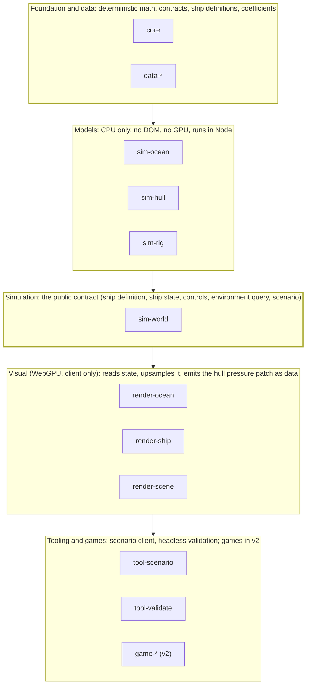

# Separation of concerns

Oct 20, 2026 · @Niilo

## Bottom line

The engine is split along one seam: an **authoritative, deterministic CPU simulation** that runs identically on client and server, and a **GPU visual layer** that only upsamples what the simulation already decided. Games sit on top of both and never reach below the simulation's public contracts. The seam is made concrete by a single interface, the environment query (water height and velocity, wind, depth at a point), which the simulation consumes and which has two implementations: a CPU one for authority and a GPU one for looks.

## Package map

Dependencies flow one way, from data down to games. Nothing below sim-world is public; the simulation never imports from a visual, tool or game package.

The highlighted band is the only thing a game or renderer talks to; the models beneath it are implementation.

## What runs where

Everything that produces a force on a boat is authoritative and runs on CPU; everything that only produces pixels runs on the GPU and is driven by authoritative state. Where a visual system would like to feed back into forces (wakes hitting other boats, fine cloth detail), it does not in v1; the coarse CPU version carries the physics and the GPU version carries the look.

| Subsystem                                  | Authoritative (CPU, client + server)                                                           | Visual (GPU, client only)                                                            |
| ------------------------------------------ | ---------------------------------------------------------------------------------------------- | ------------------------------------------------------------------------------------ |
| Background sea                             | Spectrum definition and seed; analytic height/velocity sampling at query points                | FFT cascades, foam, shading                                                          |
| Local wake and coastal patch               | Not in v1; hull pressure patch is emitted as data                                              | Dispersive patch solver, Kelvin wake, run-up, reflection                             |
| Wind                                       | Coarse per-tile 2D solve, gust layer, height profile                                           | Wind streaks, sail flutter noise                                                     |
| Hull forces                                | Hydrostatics from mesh at heel, regression tables, VLM matvec, cross-flow drag, panel buoyancy | Waterline and spray decals                                                           |
| Rig                                        | XPBD constraint graph, spars, rest-length controls                                             | Catenary line rendering                                                              |
| Sails                                      | Coarse cloth (6×6 per sail), per-triangle polar forces                                         | Fine cloth (20×20) upsampled from the coarse corners and pressure, wrinkles, flutter |
| Deck water                                 | Sheet mass and centroid as a moving mass, from a 1D estimate                                   | Deck shallow-water grid and spray particles                                          |
| Rigid bodies, contacts, mooring, grounding | Yes                                                                                            | Nothing                                                                              |

## Contracts

The simulation exposes five typed contracts; nothing else is public. Games, renderers and tools depend on these and on nothing inside.

| Contract          | What it is                                                                                                                                                                                                                             | Who produces it                                                                      | Who consumes it                 |
| ----------------- | -------------------------------------------------------------------------------------------------------------------------------------------------------------------------------------------------------------------------------------- | ------------------------------------------------------------------------------------ | ------------------------------- |
| Ship definition   | Static description of a boat: hull mesh and mass distribution, regression family and coefficients, VLM lattice, rig constraint graph with attach points, sail list with polars and cloth constants, control endpoints with rate limits | Data packages, built from the parametric models and ORC/drawing data                 | Simulation                      |
| Ship state        | Pose, velocities, constraint rest lengths, coarse cloth positions, flooding mass; serialisable, small, versioned                                                                                                                       | Simulation                                                                           | Renderer, networking, replays   |
| Ship controls     | Named inputs with units and rate limits: rudder angle, each sheet/brace/halyard target length, cant angle, ballast; a tallship order is a bundle of these with execution time                                                          | Games, test clients, AI                                                              | Simulation                      |
| Environment query | Water height and surface velocity, wind vector, depth, current at a point and time; plus a hull pressure patch output                                                                                                                  | CPU implementation in the simulation; GPU implementation in the renderer for visuals | Simulation (CPU only); renderer |
| Scenario          | Start state: ships and their definitions, positions and velocities, sea state and wind, bathymetry tile, time; plus expected outcomes for tests                                                                                        | Test client, validation suite                                                        | Simulation, renderer            |

## Determinism

The authoritative core is a fixed 60 Hz integer tick with a seeded RNG and no wall-clock reads. JavaScript's Math.sin and friends differ across engines, so the core uses its own deterministic transcendental approximations (or runs in Wasm from one compiled source) for anything that feeds state. GPU results never enter authoritative state. Server authority with client prediction is the networking model; the simulation does not know networking exists.

## Packages

| Package         | Layer      | Holds                                                                                                        |
| --------------- | ---------- | ------------------------------------------------------------------------------------------------------------ |
| `core`          | foundation | Vectors, quaternions, deterministic math, fixed-step clock, seeded RNG, units, contract type definitions     |
| `data-*`        | data       | Ship definitions, regression coefficients, polars, bathymetry tiles; pure data, versioned                    |
| `sim-ocean`     | model      | Spectrum, analytic sampling, wind solver, depth and current                                                  |
| `sim-hull`      | model      | Hydrostatics from mesh, regression library, VLM, cross-flow, panel buoyancy                                  |
| `sim-rig`       | model      | XPBD solver, constraint graph, spars, coarse cloth, polar evaluation                                         |
| `sim-world`     | simulation | Assembles ships from definitions, steps the world, contacts, mooring, grounding; the only package games call |
| `render-ocean`  | visual     | FFT, dispersive patch, foam, deck water, wind streaks (WebGPU)                                               |
| `render-ship`   | visual     | Hull, rig catenaries, fine cloth, spray (WebGPU)                                                             |
| `render-scene`  | visual     | Camera, sky, lighting, post                                                                                  |
| `tool-scenario` | tooling    | The test and showcase client: scenario loader, full parameter UI, plots, replays                             |
| `tool-validate` | tooling    | Headless benchmark runner in Node: polars, sternway, drift, broach, rig and sail tests against targets       |
| `game-*` (v2)   | game       | Networking, weather authority, towns, economy, courses, procedural maps, abstracted controls                 |

Dependency direction is one way: data → core → model → simulation → visual → tooling and game. A visual package reads simulation state and emits the hull pressure patch back only as data; it never calls into the model packages' solvers. Games depend on `sim-world` and the renderers, never on a model package directly.

## Repository rules

- One pnpm workspace, TypeScript throughout, Wasm for the hot core if profiling demands it.
- `sim-*` packages have no DOM, no WebGPU, no timers; they must run in Node for `tool-validate` and on the server.
- Each contract is a schema with a version; a breaking change bumps it and ships a migration for scenarios and ship definitions.
- Every benchmark in the Hull and Aero tabs is a scenario in `tool-validate`; CI runs them headless.
- v1 scope: `core`, the three `sim-*` packages, `sim-world`, the three renderers and both tools, with the H-boat, Suomen Joutsen and one schooner as data. Games start only when the validation suite is green.
